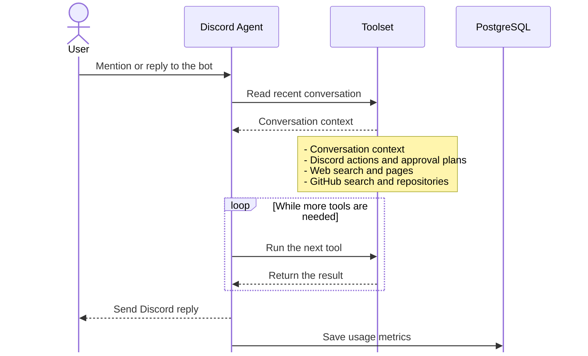
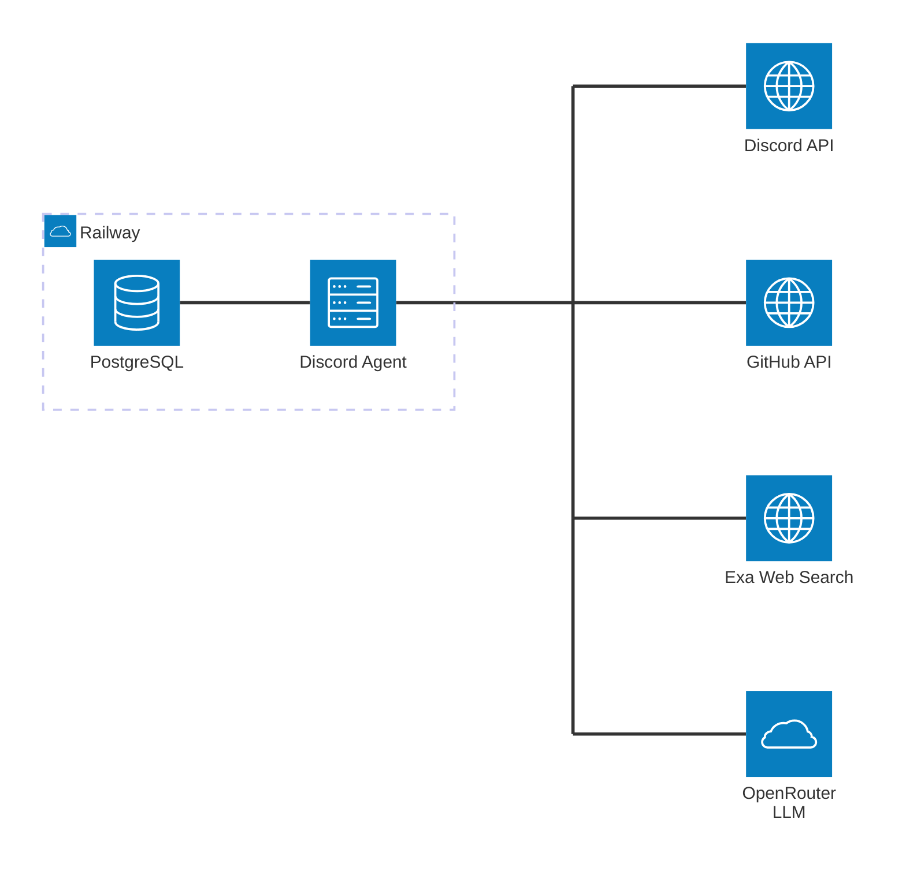

# Discord Agent

Discord Agent is a conversational bot. Mention it or reply to it to get a concise answer that follows the conversation and uses Discord Markdown for links, mentions, and code.

## Features

- 🛠️ Manage channels, threads, roles, events, and more, with permission checks and approval for server changes.
- 🔎 Search the web, read source pages, and get answers with citations.
- 🐙 Explore public GitHub repositories, code, issues, and pull requests.
- 🔍 Get code reviews with concrete findings and suggested fixes.
- 💻 Run code in a virtual machine.
- 🖼️ Analyze and process images.

## Architecture

Discord events trigger replies and handle approval buttons. The OpenRouter model reads recent conversation context and calls tools for Discord, web search, and GitHub. The bot checks permissions and waits for the requester’s approval before applying server changes. A scheduled job refreshes the OpenRouter quota, and PostgreSQL stores pending approvals, model usage, and reply errors.

The tool loop can read conversation context, perform Discord actions, propose Discord changes for approval, search the web and read pages, and search GitHub and read repositories. The model uses each result to decide what to do next. It replies when the request is handled or the step limit is reached, then the bot records usage.

### Message flow

### Service architecture

Railway hosts the Discord Agent application and its PostgreSQL database. The application connects to the Discord and GitHub APIs, Exa for web search, and OpenRouter for LLM inference.

## Development

Use Node.js and pnpm. Follow [AGENTS.md](AGENTS.md) when working with coding agents.

Enable the Message Content and Server Members intents for your Discord bot. Set the database URL and service credentials in your environment or a local `.env` file. The bot applies database migrations at startup. See [src/utils/env.ts](src/utils/env.ts) for variable descriptions and defaults.

| Command | Purpose |
| --- | --- |
| `pnpm install --frozen-lockfile` | Install dependencies from the lockfile. |
| `pnpm run dev` | Start the bot and restart it when source files change. |
| `pnpm run start` | Start the bot. |
| `pnpm run ts:check` | Check TypeScript types. |
| `pnpm run lint:fix` | Run ESLint and apply available fixes. |
| `pnpm run db:migration:create` | Generate a migration after changing the database schema. |
